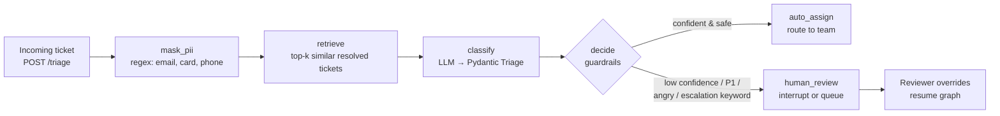

# Customer Ticket Resolution: Agentic AI for Support Triage

An AI system that reads incoming customer support tickets, decides **what they are, how urgent they are and which team should handle them**, and automatically routes the safe ones. Risky or uncertain tickets go to a human.

It is built as a **LangGraph state machine** with PII masking, retrieval of similar past tickets, structured LLM output, rule-based guardrails and a human-in-the-loop interrupt. It also includes an **evaluation harness** and a notebook that **benchmarks the agent against a classical ML baseline**.


---

## Highlights

- **Multi-step agent workflow** in LangGraph: `mask_pii → retrieve → classify → decide → auto_assign | human_review`.
- **Human-in-the-loop** with LangGraph `interrupt()`. In interactive mode the graph pauses for a reviewer and resumes with their overrides. In batch mode, risky tickets go to a review queue instead.
- **Structured, validated LLM output.** The model must return a Pydantic `Triage` object (category, priority, team, sentiment, duplicate-of, confidence, reason).
- **Guardrails, not blind trust.** Tickets go to a human on low confidence, P1 priority, angry sentiment or escalation keywords (for example *"chargeback"*, *"data breach"*, *"lawyer"*). If the model invents a team name, the ticket falls back to the default team at reduced confidence.
- **Fails safe.** Any LLM or parsing error produces a zero-confidence result, which always goes to a human, so a model outage never auto-routes a ticket.
- **Privacy first.** Emails, card numbers and phone numbers are masked before any text reaches the LLM.
- **Prompt-injection aware.** The system prompt treats ticket text as customer content, never as instructions.
- **Retrieval-augmented.** Similar resolved tickets (TF-IDF) are given to the LLM as few-shot context. A ChromaDB + Gemini-embeddings knowledge base handles semantic search over support articles.
- **Measured, not guessed.** `evals/run_eval.py` scores the agent against a held-out, human-labelled golden set. The notebook compares it with a TF-IDF + logistic regression baseline, including a confidence-calibration check.
- **Provider-agnostic.** You can switch between Google Gemini and Groq (Llama 3.3 70B) with one environment variable. Langfuse tracing is optional.

---

## Architecture



| Node | What it does |
|---|---|
| `mask_pii` | Replaces emails, card numbers and phone numbers with `[EMAIL]`, `[CARD]` and `[PHONE]` tokens. |
| `retrieve` | Finds the most similar previously resolved tickets (TF-IDF cosine similarity with a minimum-score threshold). |
| `classify` | Calls the LLM with the system prompt, the similar tickets and the new ticket. Output must match the `Triage` schema. |
| `decide` | Applies configurable business rules and records *why* a ticket needs a human. |
| `auto_assign` / `human_review` | Finalises the route. Human review either pauses the graph (`interrupt`) or adds the ticket to a queue. |

### Knowledge-base investigation agent (work in progress)

A second module (`app/agents/`, `app/rag/`, `app/services/`) explores a **tool-calling investigator agent** for a hotel-booking support domain:

- A SQLite business database (`data/support.db`) with customers, hotels, bookings and tickets, seeded with synthetic data generated by Faker.
- An allow-listed tool registry: `lookup_ticket`, `lookup_booking`, `lookup_customer`, `lookup_customer_history` and `search_support_knowledge`.
- A RAG pipeline that loads, chunks, embeds (Gemini `gemini-embedding-001`) and stores knowledge-base articles in **ChromaDB** for semantic search.
- An agent loop (max 5 iterations) that gathers evidence with tools and separates verified facts from assumptions.

---

## Tech stack

| Area | Tools |
|---|---|
| Agent orchestration | LangGraph (StateGraph, conditional edges, `interrupt`, MemorySaver checkpointer) |
| LLMs | Google Gemini, Groq (Llama 3.3 70B), via LangChain |
| Structured output | Pydantic v2 |
| Retrieval | scikit-learn TF-IDF, ChromaDB, Gemini embeddings |
| API | FastAPI, Uvicorn |
| Data and evaluation | pandas, scikit-learn, matplotlib, Jupyter |
| Storage | SQLite |
| Observability | Langfuse (optional) |

---

## Project structure

```
CustomerTicketResolution/
├── app/
│   ├── graph.py            # LangGraph workflow: nodes, guardrails, human-in-the-loop
│   ├── runner.py           # runs a ticket through the graph (batch / interactive)
│   ├── api.py              # FastAPI webhook: POST /triage, GET /queue
│   ├── schemas.py          # Pydantic Triage contract
│   ├── config.py           # teams, thresholds, escalation keywords (all tunable)
│   ├── llm.py              # Gemini / Groq provider switch + Langfuse callbacks
│   ├── pii.py              # PII masking
│   ├── retrieval.py        # TF-IDF similar-ticket search
│   ├── agents/             # tool-calling investigator agent (WIP)
│   ├── rag/                # ChromaDB ingest + semantic retrieval
│   └── services/           # SQLite data access + synthetic data generator
├── data/                   # synthetic tickets, golden eval set, knowledge base
├── evals/run_eval.py       # accuracy against the golden set
└── triage_baseline_vs_llm.ipynb   # baseline vs agent comparison + calibration
```

---

## Getting started

**Requirements:** Python 3.12, and a free API key from [Google AI Studio](https://aistudio.google.com/) or [Groq](https://console.groq.com/).

```bash
git clone https://github.com/Sumit-Kumar-Garg/AgenticAI.git
cd AgenticAI/CustomerTicketResolution

python3.12 -m venv .venv
source .venv/bin/activate
pip install --upgrade pip
pip install -r requirements.txt chromadb langgraph langchain-google-genai langchain-groq google-genai pandas scikit-learn matplotlib jupyterlab
```

Create a `.env` file:

```env
LLM_PROVIDER=gemini            # or: groq
GOOGLE_API_KEY=your-key        # for Gemini
# GROQ_API_KEY=your-key        # for Groq
# GEMINI_MODEL=gemini-2.5-flash
# WEBHOOK_TOKEN=optional-shared-secret
# LANGFUSE_PUBLIC_KEY=... / LANGFUSE_SECRET_KEY=...   (optional tracing)
```

### Run

```bash
# Triage API: POST /triage, GET /queue  (docs at http://127.0.0.1:8000/docs)
uvicorn app.api:api --reload

# Evaluate against the held-out golden set
python -m evals.run_eval

# Baseline vs agent comparison
jupyter lab triage_baseline_vs_llm.ipynb
```

Example request:

```bash
curl -X POST http://127.0.0.1:8000/triage \
  -H "Content-Type: application/json" \
  -d '{"ticket_id": "T-1001", "text": "I was charged twice this month, please refund one. Email: jane@example.com"}'
```

The response includes `category`, `priority`, `team`, `sentiment`, `confidence`, `reason`, `route` (`auto_assigned` or `human_review_queue`) and the `reasons` a human was needed.

---

## Evaluation approach

- `data/resolved_tickets.csv` is the retrieval knowledge base. `data/golden_tickets.csv` is a **separate, human-labelled test set**. They are kept apart so retrieval can't leak the answers.
- `run_eval.py` reports category, priority and team accuracy, the share sent to humans and, most importantly, **accuracy on auto-assigned tickets**. That last number decides whether auto-routing is safe to switch on.
- The notebook trains a **TF-IDF + logistic regression baseline** on the same data. It plots confusion matrices, compares the baseline with the agent side by side and checks **confidence calibration**, which tells you where to set `CONFIDENCE_THRESHOLD`.

---

## Design decisions

- **Why a graph instead of one prompt?** Each step is testable on its own. Guardrails stay deterministic code rather than prompt text, and human review fits in naturally as a pause and resume.
- **Why TF-IDF for similar tickets?** It's free, fast and runs on CPU with no model downloads. Swap in embeddings if the evals show retrieval is the bottleneck.
- **Why compare with a baseline?** An LLM only earns its cost and latency if it clearly beats a cheap classical model on the same labelled data.

## Roadmap

- [ ] Finish the tool-calling investigator agent and expose it via `POST /tickets/investigate`
- [ ] Persist the review queue (SQLite / ticketing-system API) instead of in-memory
- [ ] Grow the golden set and publish evaluation results
- [ ] Unit tests for PII masking, guardrails and graph routing
- [ ] Docker image and CI

---

All data in this repo is synthetic, generated with Faker. It contains no real customer information.
